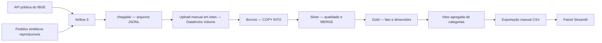

# Quem Faz — Big Data & Data Integration

**FIAP Global Solution 2026.2 · CitizenTech · Engenharia de Software**

> **Prova de conceito acadêmica.** Os pedidos, propostas, contratações e conclusões são **sintéticos**, não representam usuários ou serviços reais. Os distritos de São Paulo são provenientes da API pública do IBGE.

## 1. Visão geral

O **Quem Faz** é uma plataforma conceitual que conecta contratantes a profissionais de serviços na cidade de São Paulo. O contratante pode **explorar categorias e solicitar propostas** ou **publicar uma necessidade** para receber propostas. O componente de Big Data prepara informações para acompanhar categorias, regiões, propostas, contratações e serviços concluídos.

Este repositório contém **o componente de dados e um painel demonstrativo**, não o sistema completo de contratação da equipe. O painel lê uma exportação CSV da camada Ouro; **não há conexão em tempo real** entre Databricks e Streamlit.

## 2. Integrantes

| Integrante | RM |
|---|---|
| [Kaue Pastori Teixeira] | [RM98501] |
| [Nicolas Boni] | [RM551965] |
| [Guilherme Brazioli] | [RM98237] |
| [Pedro Oliveira] | [RM551445] |
| [Enzo Vazquez] | [RM94618] |


## 3. Arquitetura do fluxo



O DAG `quem_faz_coleta_diaria` executa **duas tarefas de origem em paralelo** (`coletar_ibge_real` e `gerar_pedidos_sinteticos`) e, após ambas, a tarefa `conferir_arquivos`. No ambiente acadêmico com Databricks Free Edition, a transferência de `chegada/` para o Volume é **manual**.

## 4. Fontes e proveniência

| Fonte | Origem | Formato | Frequência no protótipo | Natureza |
|---|---|---|---|---|
| Distritos de São Paulo | [API de Localidades do IBGE](https://servicodados.ibge.gov.br/api/v1/localidades/municipios/3550308/distritos) | JSON → JSONL | Coleta diária | Externa, real |
| Pedidos Quem Faz | Gerador determinístico em `src/quem_faz/pipeline.py` | JSONL | Lote diário | Interna, sintética |

O gerador cria pedidos identificados por data, com `simulado = true`, categorias, distrito, status e número de propostas. Não há pessoas, prestadores, avaliações ou contratações reais nessa base.

## 5. Organização do repositório

```text
quem-faz-bigdata/
├── amostras/                  # exemplos e instruções de amostras
├── dags/                     # DAG do Apache Airflow
├── docs/                     # documentação do fluxo e das fontes
├── mvp/                      # painel Streamlit, validação, testes e CSV agregado
│   ├── app.py
│   ├── validacao.py
│   ├── dados/categorias_publicas.csv
│   └── tests/
├── sql/
│   ├── 01_bronze.sql
│   ├── 02_prata_silver.sql
│   ├── 03_ouro_gold.sql
│   ├── 04_cinco_consultas.sql
│   ├── 05_view_mvp.sql
│   └── 06_qualidade_silver.sql
├── src/quem_faz/pipeline.py  # coleta e geração de arquivos
├── tests/test_pipeline.py
├── docker-compose.yml
├── executar_local.py
├── README_SQL.md
└── README.md
```

As pastas `chegada/`, `airflow-data/`, caches, arquivos secretos e evidências locais estão excluídos pelo `.gitignore`. Os prints relevantes são incluídos **no relatório acadêmico em PDF**, após revisão de informações sensíveis.

## 6. Como reproduzir

### 6.1. Pré-requisitos

- Python 3 e `pip` (o ambiente testado utilizou Python 3.14).
- Docker Desktop com WSL2 e Docker Compose para executar o Airflow local.
- Acesso ao Databricks Free Edition e um SQL Warehouse.
- Acesso à internet para consultar a API oficial do IBGE.

### 6.2. Coleta local e testes

Execute no PowerShell, a partir da raiz do repositório:

```powershell
python -m pip install tzdata
python -m unittest discover -s tests -v
python executar_local.py pedidos
python executar_local.py ibge
python executar_local.py todos
```

Os dados são gerados em `chegada/`, identificados pela data. O gerador de pedidos é determinístico para a mesma data e quantidade; a coleta do IBGE depende da disponibilidade da API.

### 6.3. Airflow 3 via Docker

```powershell
docker compose up -d
docker compose ps
```

Acesse `http://localhost:8080` e execute o DAG `quem_faz_coleta_diaria`. Consulte os logs com:

```powershell
docker compose logs --tail 60 airflow
```

Para interromper:

```powershell
docker compose down
```

**Segurança:** o Airflow de laboratório possui autenticação local; não publique senhas, capturas que as exibam ou conteúdo de `airflow-data/`.

### 6.4. Databricks: Bronze, Silver e Gold

1. No catálogo `workspace`, crie o schema `quem_faz` e o Volume gerenciado `volume_entrada`.
2. Crie os diretórios `lote_01` e `lote_02` no Volume.
3. Faça upload, pela interface, dos JSONL de **10/11/2026** e **11/11/2026** nos respectivos lotes. Para uma nova execução, utilize arquivos e datas realmente coletados.
4. No SQL Editor, execute os scripts desta ordem:
   - `sql/01_bronze.sql` — `COPY INTO` incremental por arquivo;
   - `sql/02_prata_silver.sql` — tratamento e `MERGE` por chave;
   - `sql/06_qualidade_silver.sql` — auditoria e três regras de qualidade;
   - `sql/03_ouro_gold.sql` — fato, dimensões e integridade;
   - `sql/04_cinco_consultas.sql` — análises para o produto;
   - `sql/05_view_mvp.sql` — visão pública agregada.

**Atenção:** alguns scripts usam `CREATE OR REPLACE TABLE`, portanto foram preparados para um **ambiente demonstrativo** e podem substituir tabelas analíticas. Leia os comentários antes de executar em outro ambiente. O `COPY INTO` controla arquivos já carregados; o `MERGE` consolida pela chave de negócio.

### 6.5. Painel Streamlit

O painel lê `mvp/dados/categorias_publicas.csv`, exportado manualmente da view `workspace.quem_faz.gold_vw_categorias_publicas`:

```sql
SELECT *
FROM workspace.quem_faz.gold_vw_categorias_publicas
ORDER BY total_pedidos DESC;
```

Na raiz do repositório, rode:

```powershell
python -m pip install -r mvp/requirements.txt
python -m unittest discover -s mvp/tests -v
cd mvp
python -m streamlit run app.py
```

Abra `http://localhost:8501` e filtre pela categoria **Hidráulica**. O resultado de demonstração é **43 solicitações, 30 pedidos com propostas, 19 contratados ou concluídos e 11 concluídos**. Para atualizar os dados, exporte a view novamente e substitua o CSV sem modificar suas colunas.

## 7. Resultados observados no ambiente acadêmico

| Etapa | Resultado demonstrado |
|---|---|
| Airflow | DAG com 2 tarefas de coleta paralelas e conferência, execuções bem-sucedidas |
| Bronze — pedidos | 200 registros, 200 IDs únicos |
| Bronze — distritos | 192 linhas brutas em 2 coletas, 96 IDs oficiais únicos |
| Bronze — reexecução | 0 inserções adicionais no `COPY INTO` dos arquivos reprocessados |
| Silver — pedidos | 200 pedidos, 200 chaves únicas |
| Silver — distritos | 96 distritos, 96 chaves únicas |
| Qualidade — base de pedidos | 200 válidos, 0 rejeitados nas três regras medidas |
| Qualidade — cenários controlados | 4 casos: 1 aprovado e 3 rejeitados (1 por regra) |
| Gold — modelo dimensional | 1 tabela fato (`gold_fato_pedidos`), 2 dimensões, 200 pedidos |
| Integridade da Gold | 0 categorias ou distritos sem correspondência |
| Consumo pelo painel | 6 categorias, filtros e indicadores a partir de CSV agregado |

### Cinco consultas de negócio

| Pergunta | Síntese do resultado sintético |
|---|---|
| 1. Quais categorias têm mais pedidos? | Hidráulica: **43** pedidos (**21,5%**) |
| 2. Quais distritos têm mais solicitações? | Tucuruvi: **23** (**11,5%**); Itaquera e Vila Mariana: **22** cada |
| 3. Quantos pedidos recebem propostas? | **141/200 (70,5%)**, total de **613** propostas |
| 4. Qual categoria tem maior taxa de contratação? | Montagem de móveis: **24/33 (72,73%)** |
| 5. Qual resultado operacional é demonstrado? | **95** pedidos contratados ou concluídos; **51** concluídos (**25,5%** dos 200) |

As cinco consultas SQL estão em `sql/04_cinco_consultas.sql`. Os resultados medem **o funcionamento do cenário simulado**, não impacto social, geração de renda ou demanda real de São Paulo.

## 8. Contrato de consumo e cuidados com a LGPD

- O pipeline utiliza dados reais **apenas para a malha de distritos** do IBGE; os registros operacionais são sintéticos.
- O identificador da fato é transformado por SHA-256, mas hash, por si só, **não garante anonimização**.
- A view `gold_vw_categorias_publicas` disponibiliza **apenas estatísticas agregadas por categoria** e o rótulo `DADOS SIMULADOS`.
- O CSV consumido pelo Streamlit tem as colunas `categoria`, `total_pedidos`, `pedidos_com_proposta`, `pedidos_contratados`, `servicos_concluidos`, `taxa_conclusao_percentual` e `origem_dados`.
- Não há atualização automática, API pública de produção, contas reais nem dados de contato de prestadores.
- Uma implantação real exigiria controles de acesso, retenção, auditoria, medidas de segurança e avaliação de bases legais apropriadas.

## 9. Testes e limites

- `tests/test_pipeline.py`: testes da geração de pedidos e isolamento da fonte de teste.
- `mvp/tests/test_validacao.py`: três testes do contrato CSV (incluindo formato, origem simulada e consistência).
- O projeto demonstra a **camada de dados** do Quem Faz. A interface Streamlit é uma prova de consumo analítico, não substitui o fluxo completo de contratação desenvolvido por outras disciplinas.
- O upload no Volume e a atualização do CSV são **etapas manuais** no ambiente educacional.

## 10. Referências

- [API de Localidades do IBGE](https://servicodados.ibge.gov.br/api/docs/localidades)
- [Apache Airflow](https://airflow.apache.org/docs/)
- [Databricks COPY INTO](https://docs.databricks.com/aws/en/sql/language-manual/delta-copy-into)
- [Databricks MERGE INTO](https://docs.databricks.com/aws/en/sql/language-manual/delta-merge-into)
- [Streamlit](https://docs.streamlit.io/)

**Repositório:** https://github.com/KauePastori/quem-faz-bigdata
